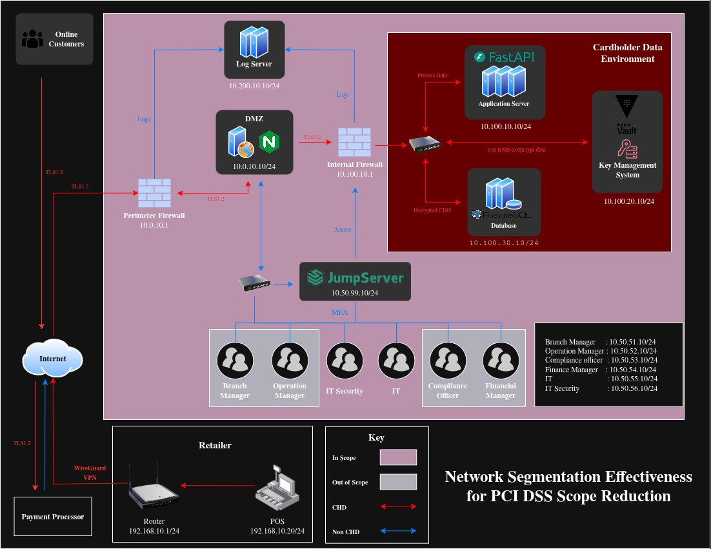

# Network Segmentation Effectiveness for PCI DSS Scope Reduction

A Docker Compose laboratory that demonstrates how logical network segmentation, default-deny firewalls, encrypted transport and cryptographic protection of card data can shrink the PCI DSS assessment boundary from a flat network to a defensible Cardholder Data Environment (CDE).

This project was built during my first internship at ACLEDA Bank Plc (April 20 to July 20, 2026) as part of the Bachelor of Telecommunication and Networking program at the Cambodia Academy of Digital Technology (CADT), specialization in Cyber Security. It was defended on July 31, 2026.

> **Disclaimer.** The lab uses synthetic data only and demonstrates selected technical controls aligned with PCI DSS v4.0.1. It is not a production payment system, a formal assessment or evidence of PCI DSS certification.



## Table of Contents

- [Network Segmentation Effectiveness for PCI DSS Scope Reduction](#network-segmentation-effectiveness-for-pci-dss-scope-reduction)
  - [Table of Contents](#table-of-contents)
  - [Overview](#overview)
  - [Scope Reduction Result](#scope-reduction-result)
  - [Architecture](#architecture)
    - [Trust zones](#trust-zones)
    - [Components](#components)
    - [Approved traffic](#approved-traffic)
  - [Quick Start](#quick-start)
    - [Prerequisites](#prerequisites)
    - [Step 1: Start the lab](#step-1-start-the-lab)
    - [Step 2: Open the demo interface](#step-2-open-the-demo-interface)
    - [Step 3: Stop or reset the lab](#step-3-stop-or-reset-the-lab)
  - [Test Scenarios](#test-scenarios)
  - [Cardholder Data Protection](#cardholder-data-protection)
  - [Security Validation](#security-validation)
  - [PCI DSS v4.0.1 Coverage](#pci-dss-v401-coverage)
  - [Repository Structure](#repository-structure)
  - [Limitations](#limitations)
  - [Resources](#resources)
  - [Author and Acknowledgment](#author-and-acknowledgment)

## Overview

In a flat network, any system that can reach the payment environment becomes part of the PCI DSS scope. This increases audit effort, widens the attack surface and gives attackers room for lateral movement. This project addresses the problem with a segmented design in which only an approved, encrypted and logged path can reach the systems that handle cardholder data.

A simulated transaction travels through the following path:

```
Retail POS > WireGuard VPN > Perimeter Firewall > DMZ Reverse Proxy > Internal Firewall > Application Server > Vault KMS + PostgreSQL
```

Every hop is restricted to approved sources, ports and services. Anything outside the path is dropped, rejected and logged.

## Scope Reduction Result

| Model | Components in scope | Notes |
|---|---|---|
| Flat baseline | 20 | Docker host, 12 core services and 7 placeholder networks |
| Segmented lab | 13 | 7 CDE, 5 connected-to or security-impacting systems and 1 Docker host |
| Candidate exclusions | 7 | Isolated departmental VLANs 51 to 56 and the jumpbox placeholder |

The full classification with justifications is available in [Lab/LAB-CONTEXT.md](./Lab/LAB-CONTEXT.md).

## Architecture

### Trust zones

| Zone | Network | Subnet | Main components |
|---|---|---|---|
| Retail | `store_net` | 192.168.10.0/24 | POS, demo API, perimeter firewall |
| VPN overlay | `wg0` | 10.255.0.0/24 | POS, perimeter firewall |
| DMZ | `dmz_net` | 10.0.10.0/24 | Perimeter firewall, DMZ proxy, internal firewall |
| CDE application | `app_net` | 10.100.10.0/24 | Internal firewall, application server |
| CDE key management | `kms_net` | 10.100.20.0/24 | Application server, Vault |
| CDE database | `db_net` | 10.100.30.0/24 | Application server, PostgreSQL |
| Demo control | `ui_net` | 172.30.10.0/24 | Demo UI, demo API |
| Security tools | `security_tools_net` | 172.31.10.0/24 | ClamAV, log server |
| Administrative and departmental | `vlan99_net`, `vlan51_net` to `vlan56_net` | 10.50.x.0/24 | Isolated placeholders (optional topology profile) |

Vault and PostgreSQL sit on separate networks and cannot talk to each other directly. The application server is the only controlled intermediary between them.

### Components

| Component | Technology | Role |
|---|---|---|
| POS and POS agent | Alpine, WireGuard, FastAPI | Simulated retail terminal that creates test transactions |
| Perimeter firewall | iptables, WireGuard, socat | VPN termination and first default-deny boundary |
| DMZ proxy | Nginx | TLS termination, route filtering and rate limiting |
| Internal firewall | iptables, socat | Second default-deny boundary in front of the CDE |
| Application server | Nginx, FastAPI | Validation, simulated authorization and data protection |
| Key management | HashiCorp Vault | Transit encryption and HMAC token generation |
| Database | PostgreSQL 16 | Stores only protected transaction records |
| Log, DNS and NTP server | rsyslog, dnsmasq, chrony | Central logging, name resolution and time sync without routing between zones |
| Anti-malware | ClamAV, FreshClam, EICAR | Repository scanning and detection evidence |

### Approved traffic

Every allowed flow is documented in the traffic matrix in [Lab/LAB-CONTEXT.md](./Lab/LAB-CONTEXT.md). The main payment path uses these flows:

| Source | Destination | Port | Protection |
|---|---|---|---|
| POS | Perimeter firewall | UDP 51820 | WireGuard |
| POS (wg0) | Perimeter firewall (wg0) | TCP 443 | TLS 1.2 inside the tunnel |
| Perimeter firewall | DMZ proxy | TCP 443 | TLS passthrough |
| DMZ proxy | Internal firewall | TCP 8443 | TLS 1.2 and mutual TLS |
| Internal firewall | Application server | TCP 8443 | Passthrough with mutual TLS at the application |
| Application server | Vault | TCP 8200 | TLS 1.2, mutual TLS and AppRole |
| Application server | PostgreSQL | TCP 5432 | TLS 1.2 and client certificate |

## Quick Start

This guide assumes you are new to the project and already have Docker installed.

### Prerequisites

Docker with Docker Compose v2. Docker Desktop (Windows and macOS) or Docker Engine (Linux) both work. Make sure port 8443 is free on your loopback interface.

### Step 1: Start the lab

Open a terminal in the `Lab` folder.

```bash
cd Lab
```

Linux and macOS:

```bash
chmod +x lab.sh
./lab.sh up
```

Windows (Command Prompt):

```cmd
lab.cmd up
```

This single command creates a local `.env` file with a random database password, generates the private lab CA, TLS certificates and WireGuard keys, builds the containers and waits until every health check passes. Secrets are generated locally and are never committed to the repository.

### Step 2: Open the demo interface

Browse to [https://localhost:8443](https://localhost:8443) and accept the browser warning. The warning appears because the lab uses its own private root CA.

1. Select **New sale** and submit the prefilled synthetic card or enter your own test values.
2. Select **View background processing** to watch the hop by hop playback through WireGuard, the firewalls, the DMZ, the application, Vault and the database. The view shows the masked PAN, the Vault ciphertext and confirms that no CVV is stored.

### Step 3: Stop or reset the lab

```bash
./lab.sh down            # Windows: lab.cmd down
./lab.sh reset --yes     # Removes all containers, networks and volumes for a fresh start
```

## Test Scenarios

Open a second terminal in the `Lab` folder while the lab is running. On Windows replace `./lab.sh` with `lab.cmd`.

| Test | Command | What it proves |
|---|---|---|
| Service status | `./lab.sh verify` | The demo UI, anti-malware service and containers are healthy |
| Approved transaction | `./lab.sh demo` | A valid payment travels the full path and returns HTTP 200 with a transaction ID |
| Firewall block test | `./lab.sh deny-test` | Unauthorized cross-zone connections are blocked and logged as `PERI_FW_DROP` and `INT_FW_DROP` |
| Anti-malware detection | `./lab.sh av-test` | ClamAV detects an isolated EICAR test file and logs the alert centrally |
| On-demand scan | `./lab.sh av-scan` | Runs an immediate recursive scan of the mounted repository files |
| Time validation | `./lab.sh time` | Shows UTC time, stratum and offset across all components |
| Stored data inspection | `./scripts/demo/db-table.sh` | PostgreSQL holds only ciphertext, token and masked PAN, and has no CVV column |
| Topology view | `./lab.sh topology` | Starts the isolated out-of-scope and jumpbox placeholder containers |
| Live logs | `./lab.sh logs` | Follows Docker logs in real time |

Additional commands: `./lab.sh regenerate-secrets --yes` rebuilds the PKI and WireGuard keys after the containers are stopped. A guided walkthrough is available in [Lab/DEMO-SCRIPT.md](./Lab/DEMO-SCRIPT.md).

## Cardholder Data Protection

| Data element | Handling |
|---|---|
| CVV (SAD) | Used in memory only for simulated authorization, then overwritten. Never sent to Vault, never written to disk and no CVV column exists in the database |
| PAN display | Masked to the last four digits in the UI, responses and logs |
| PAN token | HMAC derived by Vault Transit using the `payment-token` key and stored as an opaque `tok_` value |
| PAN and expiry | Encrypted by Vault Transit using `payment-chd` (AES-256-GCM, non-exportable, auto-rotated every 720 hours) |
| Key access | The application policy allows encrypt and HMAC only. Decrypt is disabled except for an optional lab-only evidence policy |
| Database access | TLS 1.2 with a client certificate mapped to the restricted `cde_user` role, with statement logging disabled |

## Security Validation

| Tool | Purpose | Result summary |
|---|---|---|
| Nmap | Segmentation testing from 13 scanner positions | 900 port records parsed with 0 unauthorized sensitive CDE ports open |
| OpenVAS | Internal vulnerability scanning of selected components | Findings used to remove insecure defaults |
| OWASP ZAP | Web application testing | Findings reviewed and documented |
| SHA-256 checks | Payment page script and Nginx configuration integrity | Hashes matched the approved baseline |
| ClamAV and EICAR | Anti-malware deployment and detection | Detection was logged to the central server |
| Centralized logs | Firewall, transaction and malware event evidence | Allowed and blocked traffic recorded with synchronized time |

## PCI DSS v4.0.1 Coverage

Each control is classified honestly as implemented, partial, externally referenced or not implemented.

| Requirement area | Status | Notes |
|---|---|---|
| Req 1, Network security controls | Implemented in lab | Default-deny firewalls, segmentation and documented traffic matrix |
| Req 2, Secure configurations | Partial | Hardened images, minimal services and CIS Docker Benchmark alignment |
| Req 3, Account data protection | Implemented in lab | No CVV storage, masking, Vault encryption and tokenization |
| Req 4, Data in transit | Implemented in lab | WireGuard, TLS 1.2 and mutual TLS |
| Req 5, Anti-malware | Partial | Scheduled scanning only, no real-time protection |
| Req 6, Secure software | Partial | Input validation, ZAP and integrity checks, with external SAST evidence |
| Req 7 and 8, Access control | Referenced | Handled by a teammate's Active Directory work and not implemented in this lab |
| Req 10, Logging | Partial | Central syslog and time sync, with no full SIEM or 12-month retention |
| Req 11, Security testing | Referenced | Scan results kept as external evidence |
| Req 12, Governance | Documented | Scope register, traffic matrix and inventories |

Screenshot evidence is stored in the [Evidences](./Evidences) folder and named after the requirement it supports, for example `1.4.2.png` for requirement 1.4.2 or `3.5.1.png` for requirement 3.5.1.

## Repository Structure

```
.
├── Documents
│   ├── Diagram            Architecture and data flow diagrams
│   ├── Image              Images used in the report
│   ├── Report             Final internship report
│   ├── Report Guidelines  Faculty report guidelines
│   └── Slide              Defense presentation
├── Evidences              Screenshots mapped to PCI DSS requirement numbers
├── Lab
│   ├── app                Application server (Nginx and FastAPI)
│   ├── configs            Firewall, DNS, NTP, syslog and service configuration
│   ├── db                 PostgreSQL configuration and schema
│   ├── demo-api           Demo controller API
│   ├── demo-ui            Web interface for the demonstration
│   ├── docker             Dockerfiles
│   ├── docs               Supporting lab documentation
│   ├── pos-agent          POS agent service
│   ├── scripts            Secret generation, demo and test scripts
│   ├── docker-compose.yml Full lab definition
│   ├── lab.sh / lab.cmd   Lab control scripts for Linux, macOS and Windows
│   ├── DEMO-SCRIPT.md     Guided demonstration
│   ├── LAB-CONTEXT.md     Scope register, networks and traffic matrix
│   └── SECURITY.md        Security notes
└── Resources              PCI SSC standards and guidance documents
```

## Limitations

The lab runs on a single Docker host, so Docker bridge networks represent VLAN-like zones and are not real VLAN tagging or physical firewalls. Other known limitations include:

1. Administrative controls such as a functional jump server with MFA, enterprise identity governance and session recording are placeholders or external references.
2. Vault runs as a single node with demo-only decryption privileges for evidence.
3. DNS, NTP and syslog are unauthenticated and there is no complete SIEM, file integrity monitoring or long-term log retention.
4. Anti-malware covers scheduled repository scans only and egress restrictions are incomplete.
5. OpenVAS results do not qualify as an Approved Scanning Vendor (ASV) scan.
6. High availability, disaster recovery and formal incident response are not implemented.

## Resources

PCI Security Standards Council documents used in this project are included in the [Resources](./Resources) folder, including PCI DSS v4.0.1, the Guidance for PCI DSS Scoping and Network Segmentation and the Prioritized Approach. The latest versions are available in the [PCI SSC Document Library](https://www.pcisecuritystandards.org/document_library/).

## Author and Acknowledgment

| | |
|---|---|
| Author | Thy Dayuth |
| Institution | Cambodia Academy of Digital Technology, Faculty of Digital Engineering |
| Organization | ACLEDA Bank Plc |
| Supervisor | Mr. Phok Visal |
| Advisor | Mr. Meas Sothearath |

Thank you to my supervisor, advisor, the Information Security team at ACLEDA Bank Plc and the CADT faculty for their guidance throughout the internship and this project.